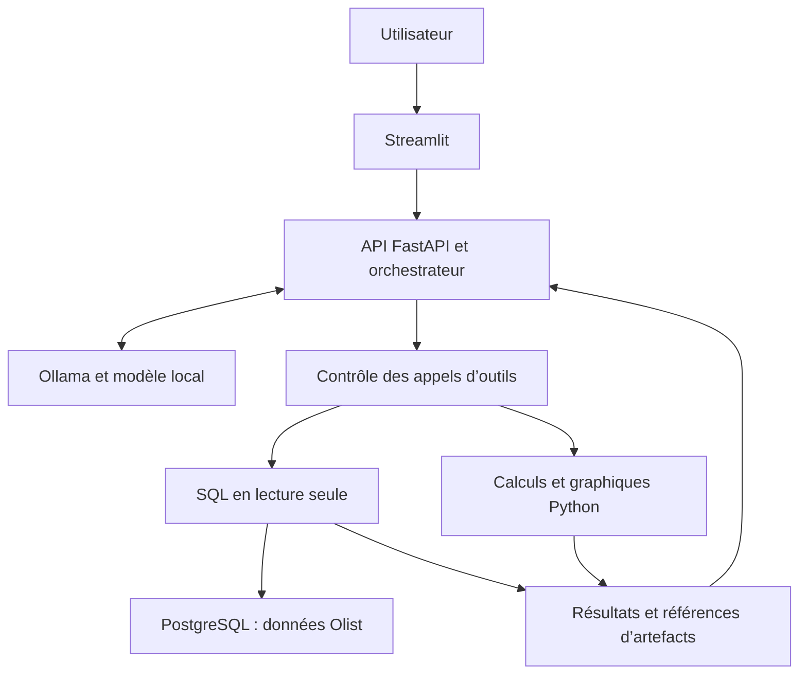

# Small Models, Big Data
## Construire un Data Analyst avec un LLM auto-hébergé

**Cas d’étude : e-commerce, dataset Olist**  
**Intervenant : Willy Rodriguez, chercheur IA chez Torus Actions**  
**Durée : 20 minutes de présentation et 10 minutes de démonstration**

## Intention de la présentation

Nous disposons de données et nous souhaitons les interroger, les explorer et comprendre leurs tendances en langage naturel. La présentation explique comment construire une interface d’analyse autour d’un modèle local, puis montre comment celui-ci utilise des outils pour répondre.

Le parcours suit cet ordre : problématique, stack technique, architecture et matériel, présentation d’Olist, questions métier, workflow agentique, démonstration.

La stack ci-dessous est une proposition cohérente pour la séance. Elle ne présume pas que tous ses composants sont déjà implémentés. Les sections « À afficher » fournissent le contenu des slides. Les notes orales développent le propos. Les annexes servent à préparer les données et les outils.

**Message central : le langage naturel permet de demander une analyse. Le système doit rendre visibles les données, les calculs et les limites de sa réponse.**

## Planning

| Slide | Sujet | Temps | Durée |
| --- | --- | --- | --- |
| 1 | Titre et cas d’étude | 0:00–0:30 | 30 s |
| 2 | Explorer des données en langage naturel | 0:30–2:30 | 2 min |
| 3 | La stack technique | 2:30–4:30 | 2 min |
| 4 | L’architecture de l’application | 4:30–6:30 | 2 min |
| 5 | Matériel et taille du modèle | 6:30–8:00 | 1 min 30 |
| 6 | Le dataset Olist | 8:00–11:00 | 3 min |
| 7 | Les questions d’analyse | 11:00–13:00 | 2 min |
| 8 | Le workflow agentique | 13:00–16:00 | 3 min |
| 9 | Contexte, contrôles et fiabilité | 16:00–19:00 | 3 min |
| 10 | Le parcours de démonstration | 19:00–20:00 | 1 min |
| Démo | Ventes, livraisons et satisfaction | 20:00–30:00 | 10 min |

---

## Slide 1 — Titre et cas d’étude

**0:00–0:30 · 30 secondes**

### À afficher

# Small Models, Big Data

**Construire un Data Analyst avec un LLM auto-hébergé**

Cas d’étude : e-commerce, dataset Olist

Willy Rodriguez — Torus Actions

### Notes orales

« Aujourd’hui, nous allons construire un assistant pour explorer un jeu de données e-commerce en langage naturel. Nous utiliserons Olist comme cas d’étude et un modèle hébergé sur notre propre machine. Je présenterai les composants et leur fonctionnement, puis nous suivrons une analyse dans l’application. »

### Visuel suggéré

Une couverture sobre avec le titre et le cas d’étude. Garder l’architecture pour la slide 4.

### Transition

« Partons de ce que nous souhaitons faire avec ces données. »

---

## Slide 2 — Explorer des données en langage naturel

**0:30–2:30 · 2 minutes**

### À afficher

**Nous avons un dataset. Nous voulons :**

- Poser des questions sur son contenu.
- Explorer les ventes et les livraisons.
- Visualiser des tendances.
- Poursuivre l’analyse avec des questions de suivi.

> « Comment évoluent les ventes ? »  
> « Quelles catégories contribuent le plus ? »  
> « Les retards de livraison sont-ils associés à de moins bonnes notes ? »

**L’utilisateur formule sa demande. L’application exécute l’analyse.**

### Notes orales

« Avec un jeu de données relationnel, une question simple demande souvent plusieurs opérations : identifier les tables utiles, choisir les filtres, écrire une requête et produire un graphique.

Nous souhaitons permettre à l’utilisateur de demander directement une analyse. Il pourra aussi poser une question de suivi : comparer deux périodes, ajouter un découpage géographique ou regarder les commandes livrées en retard.

Le code reste présent dans le système. SQL interroge les données et Python produit certains traitements ou graphiques. L’utilisateur peut commencer l’exploration sans écrire ces opérations lui-même.

Cette interaction exige cependant de préciser les termes. Le mot “ventes” peut désigner le nombre de commandes, le montant des articles ou les paiements. Une comparaison peut porter sur toutes les commandes ou uniquement sur celles qui ont été livrées.

L’assistant doit donc rendre ses choix explicites et demander une précision lorsque l’ambiguïté change le résultat. Nous voulons une interface qui facilite l’analyse tout en nous laissant vérifier comment elle a obtenu sa réponse. »

### Visuel suggéré

Une question en langage naturel et une sortie illustrative composée d’un tableau et d’un graphique. Utiliser une capture réelle dès que l’application est prête.

### Transition

« Quels composants nous faut-il pour proposer cette interaction ? »

---

## Slide 3 — La stack technique

**2:30–4:30 · 2 minutes**

### À afficher

| Couche | Choix proposé | Fonction |
| --- | --- | --- |
| Interface | Streamlit | Conversation, tableaux et graphiques |
| API applicative | FastAPI | Sessions, demandes d’analyse et résultats |
| Orchestration | Python | Appels d’outils, contrôles et limites |
| Inférence | Ollama | Service d’accès au modèle local |
| Données | PostgreSQL | Tables Olist et vues analytiques |
| Analyse et visualisation | pandas et Plotly | Traitements et graphiques |

**Deux API distinctes : celle de l’application et celle du serveur de modèle.**

### Notes orales

« Streamlit nous permet de construire une interface Python pour la démonstration. Nous y montrons les messages, les résultats tabulaires et les graphiques. FastAPI expose les opérations de notre application. L’orchestrateur peut vivre dans ce backend Python.

Ollama fournit un service d’inférence. L’application lui envoie les messages et les descriptions des outils disponibles. Avec un modèle compatible, elle peut recevoir une proposition d’appel d’outil.

L’API applicative et l’API du modèle ont des responsabilités différentes. La première connaît les sessions, les outils et les règles d’accès. La seconde produit la réponse du modèle. Le backend contrôle et exécute les opérations proposées.

PostgreSQL stocke les tables importées depuis les CSV Olist. pandas et Plotly interviennent sur les extractions pour préparer les résultats et les visualisations.

Pour un prototype très court, Streamlit pourrait appeler directement un orchestrateur Python, sans API applicative séparée. La séparation proposée ici permet de réutiliser le backend avec une autre interface. Le service d’inférence pourra également être remplacé, à condition d’adapter son contrat d’API. »

### Sources techniques

- [Streamlit](https://docs.streamlit.io/) pour l’interface Python.
- [FastAPI](https://fastapi.tiangolo.com/) pour l’API applicative.
- [Ollama : API de conversation](https://docs.ollama.com/api/chat) et [appels d’outils](https://docs.ollama.com/capabilities/tool-calling).

### Transition

« Regardons maintenant comment ces composants se parlent. »

---

## Slide 4 — L’architecture de l’application

**4:30–6:30 · 2 minutes**

### À afficher



**Le backend garde le contrôle de l’exécution et conserve les résultats.**

### Notes orales

« La question arrive dans Streamlit, puis dans le backend. Celui-ci transmet au modèle un contexte comprenant la demande, les informations métier et les outils autorisés.

Si le modèle propose une requête, le backend vérifie l’appel avant d’interroger la base. Le résultat peut revenir au modèle sous forme de résumé ou d’extrait. Le tableau complet reste accessible à l’application et aux outils.

Pour un graphique, le backend transmet les données utiles à un outil Python. Celui-ci produit un artefact que Streamlit affiche. Nous n’avons pas besoin de renvoyer chaque ligne au modèle pour qu’il résume l’analyse.

Cette architecture permet de distinguer l’inférence et le traitement des données. Les requêtes s’exécutent dans PostgreSQL. Les calculs et graphiques utilisent le CPU et la mémoire système. Le modèle utilise principalement le GPU pour l’inférence dans la configuration de la démo.

Dans ton installation, le serveur Ollama peut tourner sur la machine GPU et le backend sur une autre machine du réseau local. L’interface dialogue avec le backend, qui dialogue avec le serveur de modèle et les outils. »

### Transition

« Cette séparation explique aussi ce que nous devons dimensionner côté matériel. »

---

## Slide 5 — Matériel et taille du modèle

**6:30–8:00 · 1 minute 30**

### À afficher

**Configuration d’inférence prévue : NVIDIA RTX 4090, 24 Go de VRAM**

| Ressource | Utilisation principale |
| --- | --- |
| Mémoire GPU | Paramètres du modèle, cache de contexte et exécution |
| CPU et RAM | Base de données, extractions et analyses Python |
| Stockage | Modèles, données et artefacts |

**Le dataset reste dans la base. Le modèle reçoit le contexte utile à la question.**

### Notes orales

« La RTX 4090 dispose de 24 Go de mémoire GPU. Cette capacité doit accueillir davantage que les seuls paramètres du modèle : le contexte et l’exécution utilisent également de la mémoire.

Pour donner un ordre de grandeur, sept milliards de paramètres à quatre bits représentent environ 3,5 Go de poids bruts. C’est un calcul théorique. Le fichier quantifié et la consommation réelle comportent des surcoûts, et le contexte augmente les besoins.

Nous choisissons donc un modèle après avoir testé son comportement avec nos outils et notre contexte. La capacité à comprendre le schéma et à produire des appels corrects compte autant que la vitesse.

Le modèle ne reçoit pas toute la base Olist dans chaque prompt. Nous lui donnons le schéma utile, les définitions et des résultats limités. Cette organisation permet de travailler sur davantage de données que ce qui peut tenir dans sa fenêtre de contexte.

Pour la séance, nous gardons un seul modèle chargé et nous relevons la latence et la mémoire réellement observées. »

### Source et préparation

- [NVIDIA : spécifications RTX 4090](https://www.nvidia.com/fr-fr/geforce/graphics-cards/40-series/rtx-4090/).
- Compléter les notes avec le nom exact du modèle, la quantification et la configuration de contexte utilisée.
- Le calcul de poids bruts est illustratif et ne constitue pas une estimation de la VRAM totale.

### Transition

« Voyons maintenant quelles informations contient Olist et comment les organiser pour l’analyse. »

---

## Slide 6 — Le dataset Olist

**8:00–11:00 · 3 minutes**

### À afficher

**Brazilian E-Commerce Public Dataset by Olist**

- Environ 100 000 commandes sur la période 2016–2018.
- Données commerciales réelles anonymisées, issues de plusieurs marketplaces au Brésil.
- Neuf fichiers CSV, comprenant les transactions, les avis et des données de référence.

| Famille de données | Utilisation dans notre cas d’étude |
| --- | --- |
| Commandes et articles | Volumes et montants de vente |
| Clients et vendeurs | Répartition géographique et activité |
| Produits et catégories | Comparaison des catégories |
| Paiements | Analyse des moyens de paiement |
| Dates de livraison et avis | Délais et satisfaction |

**Trois niveaux à distinguer : commande, article, client.**

### Notes orales

« Olist fournit un cas d’étude intéressant parce qu’il combine plusieurs aspects du parcours e-commerce : ventes, livraison et satisfaction. Il permet de montrer des jointures et des questions de suivi sur des données liées.

Pour rendre le schéma accessible au modèle, nous importons les CSV dans PostgreSQL et nous ajoutons un dictionnaire décrivant les tables, les relations et les règles de calcul.

Le point essentiel est le niveau d’observation. Une commande peut correspondre à plusieurs articles ou enregistrements de paiement. Une jointure directe entre ces éléments peut multiplier les lignes. Nous devons construire les agrégations au bon niveau avant de les combiner.

Pour les clients, le dataset distingue l’identifiant lié à une commande et l’identifiant permettant de suivre un même client sur plusieurs commandes. Cette différence devient importante lorsque l’on analyse les réachats.

Nous préparons également deux vues : l’une pour les ventes par article, l’autre pour les commandes et leur livraison. Elles centralisent les conventions et simplifient les analyses.

Les tendances et les liens entre livraison et satisfaction seront calculés pendant l’exploration. Nous n’annonçons aucun résultat avant d’avoir examiné les données. Olist constitue ici un cas d’étude relationnel, sans prétendre représenter un volume industriel de Big Data. »

### Visuel suggéré

Un extrait du schéma relationnel centré sur les commandes. Montrer les articles, clients et avis, puis mentionner les autres tables oralement.

### Sources

- [Dataset publié par Olist](https://www.kaggle.com/datasets/olistbr/brazilian-ecommerce).
- [Métadonnées et distinction des identifiants clients](https://www.kaggle.com/olistbr/brazilian-ecommerce/metadata).

### Transition

« À partir de ces informations, voici les questions que nous pouvons poser. »

---

## Slide 7 — Les questions d’analyse

**11:00–13:00 · 2 minutes**

### À afficher

| Niveau | Exemple de question |
| --- | --- |
| Décrire | Comment évoluent les commandes et le montant des articles par mois ? |
| Comparer | Quelles catégories ont le montant de vente le plus élevé ? |
| Segmenter | Comment les délais de livraison varient-ils selon l’État du client ? |
| Approfondir | Les commandes en retard reçoivent-elles des notes différentes ? |
| Interpréter | Que pouvons-nous conclure, et que faut-il encore vérifier ? |

**Une question de suivi conserve le périmètre et précise l’analyse.**

### Notes orales

« Nous pouvons commencer par décrire l’activité : commandes par mois et montant des articles. Ensuite, nous demandons un découpage par catégorie ou par région.

Ces questions mobilisent des outils différents. SQL extrait et agrège les données. Python peut calculer une statistique ou produire un graphique. Le modèle organise ces opérations et explique le résultat.

La dernière question, sur les notes des commandes en retard, exige davantage de précautions. Nous devons définir le retard, choisir les commandes éligibles et tenir compte des avis manquants. Nous montrons les effectifs de chaque groupe avec leurs notes.

La conversation facilite l’exploration, mais elle doit conserver les filtres. Si l’utilisateur dit “compare maintenant les catégories”, l’assistant doit savoir quelle période reprendre et si le statut de commande reste le même.

Nous allons suivre un parcours court : évolution des ventes, catégories, puis livraison et satisfaction. Les questions géographiques et les analyses de réachat pourront servir aux échanges après la séance. »

### Visuel suggéré

Afficher les trois questions de démo en premier. Les autres exemples peuvent apparaître ensuite pour montrer les possibilités.

### Transition

« Comment l’application passe-t-elle d’une question à une suite d’opérations ? C’est le rôle du workflow agentique. »

---

## Slide 8 — Le workflow agentique

**13:00–16:00 · 3 minutes**

### À afficher

**Un cycle d’analyse guidé par les résultats des outils**

1. Interpréter la question et ses contraintes.
2. Consulter le schéma utile.
3. Proposer un appel d’outil structuré.
4. Contrôler et exécuter cet appel.
5. Exploiter le résultat ou corriger une erreur.
6. Poursuivre l’analyse ou produire une réponse.

**L’application fixe les outils disponibles et les conditions d’arrêt.**

### Notes orales

« Une question peut nécessiter un seul appel SQL ou plusieurs étapes. Nous parlons ici de workflow agentique parce que le modèle peut choisir l’étape suivante en fonction du résultat obtenu.

Prenons la comparaison entre retards et notes. Le modèle commence par identifier les dates et les avis utiles. Il propose ensuite une extraction au niveau commande. Le backend exécute l’appel après contrôle. Le résultat peut indiquer qu’il faut traiter des dates manquantes ou préciser les effectifs.

Le modèle peut alors demander un calcul ou un graphique, puis synthétiser l’analyse. Si l’outil renvoie une erreur, une reprise limitée permet de corriger la proposition. Nous gardons une condition d’arrêt pour éviter une suite d’essais sans fin.

L’appel d’outil décrit une fonction et ses arguments. Le modèle le propose, puis le code applicatif décide comment l’exécuter. Cette distinction nous permet de limiter les opérations disponibles.

Nous conservons également un état de l’analyse : période, population, métrique, requêtes exécutées et références de résultats. Les tableaux complets restent dans l’application. Le modèle reçoit ce dont il a besoin pour décider et restituer.

Nous pouvons commencer avec quelques outils Python bien définis et une boucle simple. Un framework d’orchestration devient utile lorsque les états et les reprises se complexifient. La séance vise à comprendre ce mécanisme avant de choisir un framework. »

### Exemple pédagogique d’appel

Les fonctions et arguments ci-dessous appartiennent à la proposition d’application, et ne sont pas des fonctions fournies par Olist ou Ollama.

```json
{
  "name": "compare_delivery_reviews",
  "arguments": {
    "start_date": "2017-01-01",
    "end_date_exclusive": "2018-01-01",
    "order_status": "delivered",
    "late_definition": "actual_date_after_estimated_date"
  }
}
```

### Source technique

[Ollama : appels d’outils](https://docs.ollama.com/capabilities/tool-calling). La compatibilité doit être vérifiée pour le modèle exact utilisé.

### Transition

« Pour que ce cycle soit utile, nous devons lui fournir un bon contexte et contrôler ses opérations. »

---

## Slide 9 — Contexte, contrôles et fiabilité

**16:00–19:00 · 3 minutes**

### À afficher

| Besoin | Réponse proposée dans l’application |
| --- | --- |
| Comprendre les données | Dictionnaire, clés de jointure et vues métier |
| Conserver les choix | État explicite : période, métrique et filtres |
| Limiter les opérations | Accès SQL restreint, outils autorisés et délais |
| Vérifier les résultats | Requête, effectifs, calculs et références visibles |
| Gérer les échecs | Reprises bornées et message d’erreur explicite |

**La qualité d’une analyse dépend aussi de ses définitions et de son périmètre.**

### Notes orales

« Le contexte sert à expliquer les données, pas seulement à conserver la conversation. Nous y plaçons les définitions métier, les relations utiles et les conventions de calcul. Nous pouvons sélectionner les tables pertinentes pour chaque question afin de limiter sa taille.

Les erreurs les plus discrètes sont souvent sémantiques. Une requête correcte peut compter des articles au lieu des commandes, additionner deux fois un montant ou utiliser le mauvais identifiant client.

Nous réduisons ces risques avec des vues métier et des contrôles. Le backend utilise un compte SQL restreint et une durée maximale de requête. Pour Python, la démo peut s’appuyer sur des fonctions prédéfinies de calcul et de graphique. Si elle autorise du code généré librement, il faut un environnement d’exécution isolé.

Nous conservons la trace des actions exécutées et des résultats. Il s’agit de montrer les outils, les requêtes et les sorties utiles à la vérification. L’interface peut également afficher la durée de l’analyse et les limites signalées.

Enfin, comparons les réponses à des calculs de référence. Pour les notes et les retards, un écart observé indique une association dans les données sélectionnées. Nous devons examiner d’autres facteurs avant de conclure à un effet causal.

Ces éléments rendent la réponse utilisable : l’analyste sait quel calcul il regarde, sur quelle population et avec quelles limites. »

### Exemple à commenter

« Combien de clients avons-nous ? » appelle une clarification sur le périmètre et l’identité du client. « Quel est le chiffre d’affaires ? » appelle une définition du montant. Ces ambiguïtés se traitent dans le contexte métier et, si nécessaire, par une question à l’utilisateur.

### Transition

« Nous allons maintenant suivre ce cycle avec trois questions dans l’application. »

---

## Slide 10 — Le parcours de démonstration

**19:00–20:00 · 1 minute**

### À afficher

**Trois questions sur Olist**

1. Comment évolue le montant des articles par mois ?
2. Quelles catégories représentent le plus de ventes ?
3. Les commandes en retard reçoivent-elles de moins bonnes notes ?

**À observer : appels d’outils, tableaux, graphiques et limites.**

### Notes orales

« Nous utilisons la même période pour suivre l’analyse. Nous commencerons par un résultat agrégé, puis nous demanderons une comparaison de catégories. Enfin, nous examinerons les retards et les notes.

Je montrerai les résultats et les traces utiles, puis nous vérifierons une conclusion. L’objectif est d’observer comment une question devient une analyse et comment nous pouvons la contrôler. »

### Transition

« Commençons par l’évolution des ventes. »

---

## Démonstration — 10 minutes

### 20:00–21:00 — Présentation rapide de l’application

Montrer le modèle actif, la source Olist et les outils disponibles. Ouvrir le dictionnaire ou la liste des vues sans détailler chaque colonne.

**À dire :** « Le dataset est déjà importé. Le modèle reçoit sa description et peut demander aux outils de l’interroger. »

### 21:00–23:00 — Évolution des ventes

**Prompt :**

> Sur l’année 2017, pour les commandes au statut delivered, calcule par mois le montant des articles hors frais de livraison et le nombre de commandes distinctes. Utilise la date d’achat et exprime les montants en BRL. Affiche un tableau et un graphique de l’évolution du montant. Indique la définition de la métrique et montre la requête utilisée.

**À observer :** périmètre, agrégation SQL, distinction entre articles et commandes, graphique.

**Commentaire :** « Nous avons demandé une métrique explicite. Le système doit garder cette définition pour les questions suivantes. Le statut delivered correspond au statut observé dans l’extraction historique. »

### 23:00–25:00 — Comparaison des catégories

**Prompt :**

> Sur le même périmètre, quelles sont les dix catégories avec le montant total d’articles le plus élevé ? Affiche leurs montants, leur part dans le total et un graphique en barres. Précise le traitement des catégories manquantes.

**À observer :** maintien de la période et du statut, jointure avec les produits, dénominateur des parts.

**Commentaire :** « La part de chaque catégorie doit utiliser le total de toutes les catégories du périmètre, y compris les ventes dont la catégorie manque. »

### 25:00–28:00 — Livraisons et satisfaction

**Prompt :**

> Pour les commandes achetées en 2017 et au statut delivered, compare les notes des commandes livrées après la date estimée à celles livrées au plus tard à cette date. Compare les dates calendaires. Indique les effectifs, les notes moyennes et leur distribution. Exclue les dates ou notes manquantes du calcul concerné et indique les exclusions. Utilise la convention de sélection d’un avis par commande du dictionnaire métier. Produis un graphique et formule une conclusion descriptive.

**À observer :** extraction au niveau commande, traitement des avis multiples, groupes et effectifs, conclusion.

**Commentaire :** « Une comparaison de notes doit éviter de compter davantage une commande parce qu’elle comporte plusieurs articles. Nous interprétons l’écart avec les effectifs et la distribution des notes. »

### 28:00–29:00 — Vérification et limites

**Prompt :**

> Résume les constats de cette comparaison. Quelles limites empêchent d’affirmer que le retard cause à lui seul les différences de notes ?

Montrer un résultat de référence préparé indépendamment. Examiner les effectifs et un écart de note, puis vérifier que la réponse respecte la portée descriptive de l’analyse.

### 29:00–30:00 — Conclusion

**À dire :**

« Nous avons exploré des ventes, comparé des catégories et examiné un lien entre livraison et satisfaction avec des questions en langage naturel. L’application a exécuté les requêtes et produit les graphiques.

Le modèle coordonne ces étapes. Le schéma, les définitions et les outils déterminent aussi la qualité de l’analyse. Pour utiliser les réponses, nous avons besoin de leurs résultats vérifiables et de leurs limites. »

---

## Annexe A — Organisation proposée des données

### Fichiers à importer

| Fichier CSV Olist | Nom de table proposé |
| --- | --- |
| `olist_orders_dataset.csv` | `orders` |
| `olist_order_items_dataset.csv` | `order_items` |
| `olist_customers_dataset.csv` | `customers` |
| `olist_products_dataset.csv` | `products` |
| `olist_sellers_dataset.csv` | `sellers` |
| `olist_order_payments_dataset.csv` | `payments` |
| `olist_order_reviews_dataset.csv` | `reviews` |
| `olist_geolocation_dataset.csv` | `geolocation` |
| `product_category_name_translation.csv` | `category_translation` |

Source : [explorateur et métadonnées Olist](https://www.kaggle.com/olistbr/brazilian-ecommerce/metadata). Les noms SQL de droite sont nos conventions.

### Vues proposées

- **`sales_items`** : une ligne par article, avec la date d’achat, le statut, le prix et la catégorie. Elle sert aux montants et découpages de ventes.
- **`delivery_orders`** : une ligne par commande, avec les dates utiles, l’indicateur de retard et un avis sélectionné selon la convention ci-dessous. Elle sert à la comparaison des délais et des notes.

Ces vues sont des transformations à préparer. Vérifier leur unicité au niveau annoncé après chaque jointure. Le fichier géographique n’est pas nécessaire au parcours de démo.

## Annexe B — Conventions d’analyse à fournir au modèle

Les règles suivantes sont des choix pédagogiques proposés pour l’application. Elles doivent figurer dans son dictionnaire et correspondre aux vues.

| Sujet | Convention proposée |
| --- | --- |
| Période de démonstration | Achats du 1er janvier 2017 inclus au 1er janvier 2018 exclu |
| Population des ventes | Commandes au statut `delivered` dans l’extraction |
| Montant des articles | Somme de `order_items.price`, hors `freight_value` |
| Interprétation comptable | Montant des articles du périmètre, sans assimiler cette mesure au revenu comptable propre d’Olist |
| Commandes | Comptage distinct de `order_id` |
| Clients récurrents | Utilisation de `customer_unique_id`, si cette question est posée |
| Retard | Date calendaire de livraison effective strictement après la date estimée |
| Délai de livraison | Différence entre livraison effective et achat, avec unité annoncée |
| Avis multiples | Choisir l’avis le plus récent par date de réponse, avec un départage déterministe documenté |
| Avis absents | Exclure de la comparaison des notes et annoncer les effectifs exclus |
| Dates absentes | Exclure de la classification du retard et annoncer les effectifs exclus |
| Catégories absentes | Conserver un groupe « catégorie inconnue » dans les totaux |
| Parts de ventes | Diviser par le total du périmètre, avant la sélection du top 10 |

Vérifier les noms de colonnes et les types lors de l’import. Les conventions de sélection d’avis et de comparaison des dates appartiennent à l’application, pas au dataset d’origine.

## Annexe C — Contrat d’outils proposé

| Outil | Entrée | Sortie |
| --- | --- | --- |
| `get_schema` | Tables ou domaine d’analyse | Colonnes, relations et définitions |
| `run_readonly_sql` | Requête et paramètres | Référence du résultat, extrait, effectif et statut |
| `compute_metrics` | Référence du tableau et opération autorisée | Mesures et contrôles |
| `make_chart` | Référence du tableau, type et axes | Référence du graphique et description |

Les grands résultats restent côté application. Le modèle reçoit des extraits ou agrégats adaptés au contexte. Une sortie tronquée doit porter une indication explicite. Les références permettent de réutiliser les données sans les recopier intégralement dans chaque message.

### État minimal du workflow

- Question courante et historique utile.
- Période, population et définition de la métrique.
- Outils autorisés et nombre d’étapes restantes.
- Appels exécutés, erreurs et références d’artefacts.

### Conditions d’arrêt

- Une réponse contient les résultats requis et leurs limites.
- Une ambiguïté demande une précision de l’utilisateur.
- Les données nécessaires sont absentes.
- Le budget d’étapes ou la durée maximale est atteint.

## Annexe D — Répétition et préparation

- Importer les données et contrôler les types, clés, valeurs manquantes et cardinalités.
- Vérifier indépendamment les trois analyses de démonstration.
- Contrôler les bornes temporelles réellement présentes dans les fichiers importés.
- Tester les prompts exacts, les questions de suivi et les reprises après erreur.
- Vérifier la compatibilité du modèle avec les appels d’outils.
- Noter son nom exact, sa quantification, son contexte et les ressources observées.
- Précharger le modèle et vérifier les connexions réseau avant la séance.
- Préparer un affichage lisible à la projection et un accès rapide aux traces.
- Répéter le parcours en dix minutes et enregistrer une courte vidéo de secours.
- Présenter uniquement comme opérationnels les contrôles réellement implémentés.

## Références

Sources consultées le 1er octobre 2026. Les métriques, vues, outils et conventions de démo sont des propositions de conception. Aucun résultat sur Olist n’a été calculé pour ce document.

1. [Olist — Brazilian E-Commerce Public Dataset](https://www.kaggle.com/datasets/olistbr/brazilian-ecommerce).
2. [Olist — Métadonnées et fichiers](https://www.kaggle.com/olistbr/brazilian-ecommerce/metadata).
3. [Ollama — API de conversation](https://docs.ollama.com/api/chat).
4. [Ollama — Appels d’outils](https://docs.ollama.com/capabilities/tool-calling).
5. [Streamlit — Documentation](https://docs.streamlit.io/).
6. [FastAPI — Documentation](https://fastapi.tiangolo.com/).
7. [NVIDIA — RTX 4090](https://www.nvidia.com/fr-fr/geforce/graphics-cards/40-series/rtx-4090/).
